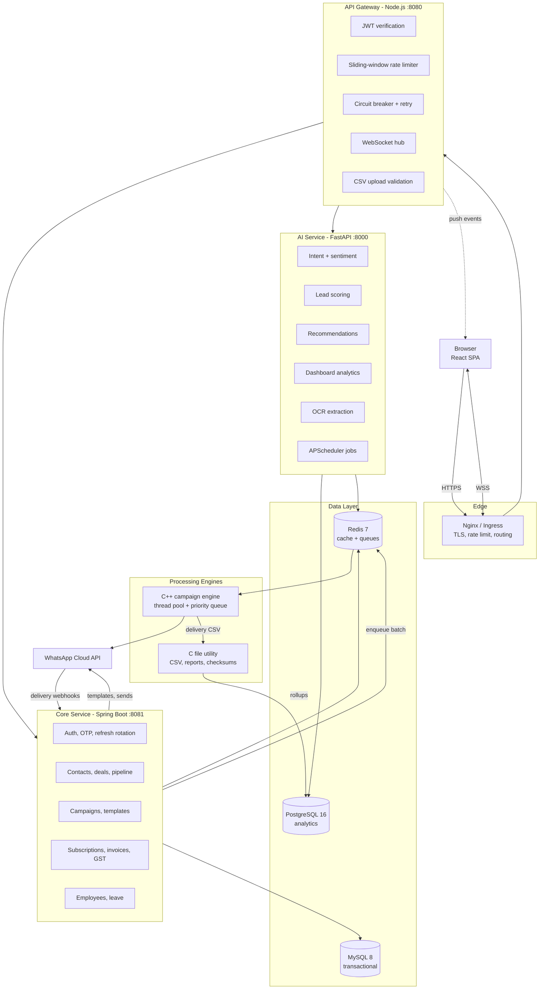

# Hubflow Automation — System Architecture

## 1. The shape of the problem

Hubflow sells one promise: a lead captured anywhere ends up in a CRM, gets messaged
on WhatsApp, and shows up correctly on an invoice. That promise breaks at the seams
between tools, so the architecture is organised around removing seams rather than
around technology preference.

Five runtimes are used, each where it earns its place:

| Runtime | Responsibility | Why this one |
|---|---|---|
| React + Vite | Marketing site, dashboard, CRM, admin UI | Component reuse across four distinct brands; route-level code splitting |
| Node.js | API gateway, WebSocket fan-out, uploads | Event loop suits many idle sockets and I/O-bound proxying |
| Java (Spring Boot) | Auth, CRM, campaigns, billing, HRMS | Transactions, JPA, Spring Security, mature validation |
| Python (FastAPI) | AI assistant, analytics, OCR, scheduled jobs | Fast iteration on models, strong async HTTP, APScheduler |
| C++ / C | Bulk dispatch engine, CSV and report utilities | Predictable throughput and memory for millions of rows |

## 2. Request topology

## 3. Why a gateway at all

The gateway is not a pass-through. It owns four things the downstream services
should not each reimplement:

1. **Token verification** happens once, at the edge. Downstream services trust the
   `x-tenant-id` and `x-user-id` headers only because the gateway sets them after
   verifying the signature, and because network policy blocks direct access to
   backend pods from anywhere except the edge tier.
2. **Rate limiting** is tenant-aware. An authenticated request is keyed on
   `tenant:<id>:<user>`, an anonymous one on IP. Login and OTP get tighter buckets
   than general traffic, so credential stuffing cannot consume a tenant's quota.
3. **Failure isolation.** Every upstream call goes through a circuit breaker with
   exponential-backoff retry on idempotent verbs. When the core service is down, the
   breaker opens after five failures and returns 503 immediately instead of stacking
   sockets. Verified behaviour: three attempts with 120/240 ms backoff, then a 502.
4. **WebSocket fan-out.** One authenticated socket per browser tab receives campaign,
   import and notification events. Backend services publish through an internal
   endpoint guarded by a shared service token rather than holding sockets themselves.

## 4. Degradation, not failure

Every cross-service dependency has a defined behaviour when the far side is gone.

| Dependency down | Behaviour | Where |
|---|---|---|
| Core service | Gateway serves the cached plan catalogue so the marketing page still renders pricing | `billing.routes.js` |
| Redis | Rate limiter silently falls back to an in-process store | `rateLimitStore.js` |
| PostgreSQL | Analytics returns a modelled series flagged `source_is_live: 0`, after a 2s connect timeout and a 30s circuit cooldown | `database.py`, `analytics.py` |
| Catalogue API | E-commerce page shows a cached sample and a retry affordance | `ProductGrid.jsx` |
| WhatsApp API | Sends are simulated with a traceable `wamid.simulated.*` id when disabled | `WhatsAppService.java` |

This matters more than it sounds. The alternative — a blank page or a hung request
— is what makes a SaaS feel unreliable even when the outage is small.

## 5. Data flow: a campaign end to end

1. An operator uploads a CSV. The gateway validates extension, MIME type, size and
   required headers, then stores it per tenant and returns a preview plus a job id.
2. The core service creates the campaign against an **approved** template. An
   unapproved template is rejected — verified in testing.
3. On dispatch, the core service materialises `campaign_recipients`, skipping
   opted-out contacts, and pushes a batch id onto the Redis dispatch queue.
4. The C++ engine drains the queue with a worker pool. Urgent and bulk traffic sit
   in separate lists so OTPs are never starved by a broadcast. Failures retry up to
   three times before landing in a dead-letter list.
5. Meta posts delivery receipts to the core service webhook. Each receipt is matched
   on `provider_message_id` — a unique index makes this a single row read — and the
   campaign counters are recomputed from the recipients table so a lost webhook
   self-corrects rather than drifting.
6. The C file utility rolls the delivery CSV into a report; the AI service rolls the
   events into `campaign_daily_metrics`.
7. Billing reads conversation counts from the same ledger the reports read, which is
   why finance and marketing numbers agree.

## 6. Security posture

- **Passwords**: BCrypt at cost 12.
- **Access tokens**: HS256 JWT, 15-minute lifetime, `tenantId` and `roles` claims.
- **Refresh tokens**: 48 bytes of CSPRNG entropy, stored only as a SHA-256 hash,
  single-use with rotation. Replaying a used token revokes the whole family —
  verified in testing.
- **OTP**: six digits, BCrypt-hashed at rest, 5-minute expiry, 5 attempts, 5 sends
  per hour per number. The plaintext code is returned only when
  `hubflow.otp.expose-code` is enabled, which is dev-only.
- **Lockout**: five failed sign-ins locks an account for fifteen minutes.
- **Authorisation**: `@PreAuthorize` at the controller plus role checks at the
  gateway, so a bypass of one layer is not a bypass of both.
- **Tenant isolation**: the tenant id always comes from the verified token, never
  from request input. Repository methods are `findByIdAndTenantId`, not `findById`.
- **Transport**: TLS 1.2+, HSTS, `nosniff`, frame options, tuned CSP at the edge.
- **Secrets**: environment variables locally, Kubernetes Secrets in cluster, sourced
  from AWS Secrets Manager through the External Secrets Operator in production.

## 7. Scaling characteristics

| Component | Scaling | Constraint |
|---|---|---|
| Frontend | CDN + 2 replicas | Static, effectively unbounded |
| Gateway | HPA 3-12 on CPU 70% | Stateless; WebSocket state is per-pod, so sticky sessions or a Redis pub/sub bus is required past one pod |
| Core service | HPA 3-10 | MySQL connection pool (20 per pod) is the real ceiling |
| AI service | HPA 2-8 | CPU-bound classification; scheduler pinned to a single replica to avoid duplicate job runs |
| C++ engine | CronJob, worker count per job | Meta's per-number throughput cap, not our CPU |
| MySQL | Vertical + read replicas | Writes stay on the primary |
| PostgreSQL | Monthly partitions, dropped after 13 months | Retires history in constant time |

## 8. Observability

- Structured JSON logs from every service, correlated by `x-request-id` which is
  generated at the gateway and propagated downstream.
- Spring Actuator exposes Prometheus metrics; pods carry scrape annotations.
- Health endpoints are split: `/health` for liveness, `/health/ready` for
  readiness, and readiness reports upstream reachability and circuit state so a
  degraded pod is pulled from the load balancer rather than serving errors.

## 9. Trade-offs taken deliberately

**Five runtimes is real operational cost.** It is justified here because the
assessment asked for it and because each has a defensible niche, but in a startup
with one team I would collapse Node and Python into a single service and keep Java
only for the transactional core.

**The AI service is deterministic, not an LLM.** Intent classification is a scored
keyword model with a documented confidence formula. It is honest about what it is,
runs offline, costs nothing per call, and gives a clean seam to swap in a hosted
model later. Confidence spreads from 0.40 (no signal) to 0.96 (multi-signal).

**Denormalised campaign counters** trade write complexity for read speed, and are
recomputed from source on every receipt so they cannot drift permanently.

**H2 in the dev profile** means a developer can run the full test suite with no
database installed; MySQL is validated in CI and production via Flyway.
