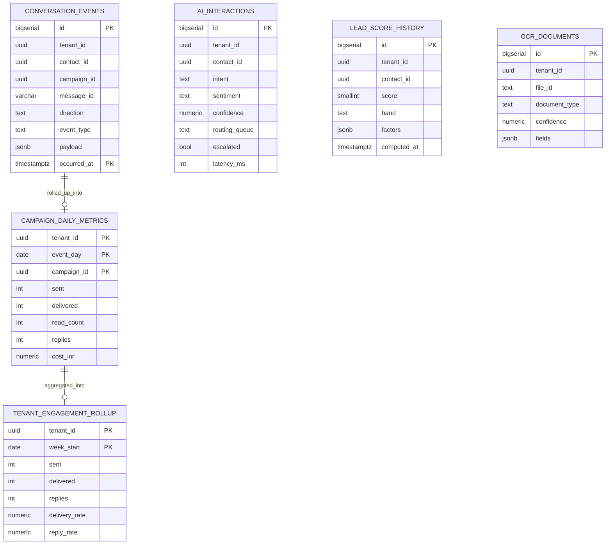

# Entity Relationship Diagram

Hubflow splits storage by workload. MySQL holds the transactional system of record.
PostgreSQL holds append-only analytical history. Redis holds nothing durable.

## MySQL — transactional core

```mermaid
erDiagram
    TENANTS ||--o{ USERS : employs
    TENANTS ||--o{ CONTACTS : owns
    TENANTS ||--o{ DEALS : owns
    TENANTS ||--o{ CAMPAIGNS : runs
    TENANTS ||--o{ MESSAGE_TEMPLATES : registers
    TENANTS ||--o{ SUBSCRIPTIONS : holds
    TENANTS ||--o{ INVOICES : billed_by
    TENANTS ||--o{ EMPLOYEES : staffs
    TENANTS ||--o{ AUDIT_LOGS : records

    USERS ||--o{ USER_ROLES : granted
    USERS ||--o{ REFRESH_TOKENS : issues
    USERS |o--o{ CONTACTS : owns
    USERS |o--o{ DEALS : owns
    USERS |o--o{ CAMPAIGNS : creates

    CONTACTS ||--o{ DEALS : generates
    CONTACTS ||--o{ CAMPAIGN_RECIPIENTS : targeted_by

    MESSAGE_TEMPLATES ||--o{ CAMPAIGNS : used_by
    CAMPAIGNS ||--o{ CAMPAIGN_RECIPIENTS : fans_out_to

    PLANS ||--o{ SUBSCRIPTIONS : priced_by
    SUBSCRIPTIONS ||--o{ INVOICES : raises

    EMPLOYEES ||--o{ LEAVE_REQUESTS : submits
    EMPLOYEES |o--o{ EMPLOYEES : reports_to

    TENANTS {
        char36 id PK
        varchar name
        varchar slug UK
        varchar gstin
        varchar whatsapp_number
        enum status
    }

    USERS {
        char36 id PK
        char36 tenant_id FK
        varchar full_name
        varchar email UK
        varchar phone
        varchar password_hash
        bool phone_verified
        int failed_login_attempts
        datetime locked_until
    }

    USER_ROLES {
        char36 user_id PK_FK
        enum role PK
    }

    REFRESH_TOKENS {
        char36 id PK
        char36 user_id FK
        varchar token_hash UK
        datetime expires_at
        datetime revoked_at
    }

    OTP_TOKENS {
        char36 id PK
        varchar phone
        varchar code_hash
        enum purpose
        datetime expires_at
        int attempts_used
        datetime consumed_at
    }

    CONTACTS {
        char36 id PK
        char36 tenant_id FK
        varchar full_name
        varchar phone UK
        varchar email
        enum lifecycle_stage
        char36 owner_id FK
        int lead_score
        bool opted_out
    }

    DEALS {
        char36 id PK
        char36 tenant_id FK
        char36 contact_id FK
        varchar title
        decimal deal_value
        enum stage
        date expected_close_date
        int win_probability
    }

    MESSAGE_TEMPLATES {
        char36 id PK
        char36 tenant_id FK
        varchar name UK
        varchar language UK
        enum category
        text body_text
        enum approval_status
        varchar quality_rating
    }

    CAMPAIGNS {
        char36 id PK
        char36 tenant_id FK
        char36 template_id FK
        varchar name
        enum status
        datetime scheduled_at
        int total_recipients
        int delivered_count
        int read_count
    }

    CAMPAIGN_RECIPIENTS {
        char36 id PK
        char36 campaign_id FK
        char36 contact_id FK
        varchar phone
        enum delivery_state
        varchar provider_message_id UK
        int retry_count
    }

    PLANS {
        varchar id PK
        varchar name
        decimal monthly_price
        decimal yearly_price
        int conversation_allowance
        int seat_limit
    }

    SUBSCRIPTIONS {
        char36 id PK
        char36 tenant_id FK
        varchar plan_id FK
        enum billing_cycle
        enum status
        datetime current_period_end
        int conversations_used
    }

    INVOICES {
        char36 id PK
        char36 tenant_id FK
        char36 subscription_id FK
        varchar invoice_number UK
        decimal platform_amount
        decimal conversation_amount
        decimal tax_amount
        decimal total_amount
        enum status
        date due_date
    }

    EMPLOYEES {
        char36 id PK
        char36 tenant_id FK
        varchar employee_code UK
        varchar full_name
        varchar department
        varchar designation
        date date_of_joining
        char36 manager_id FK
        int leave_balance
    }

    LEAVE_REQUESTS {
        char36 id PK
        char36 tenant_id FK
        char36 employee_id FK
        enum leave_type
        date start_date
        date end_date
        int day_count
        enum status
    }

    AUDIT_LOGS {
        bigint id PK
        char36 tenant_id
        char36 actor_id
        varchar action
        varchar entity_type
        json metadata
    }
```

## PostgreSQL — analytics store



## Relationship rules

| Relationship | Cardinality | Delete behaviour | Reason |
|---|---|---|---|
| `tenants -> users` | 1:N | CASCADE | A tenant's users have no meaning without the tenant |
| `tenants -> contacts` | 1:N | CASCADE | Tenant offboarding purges its CRM |
| `users -> contacts` (owner) | 1:N optional | SET NULL | Losing a rep must not delete their pipeline |
| `contacts -> deals` | 1:N | CASCADE | A deal cannot exist without its contact |
| `message_templates -> campaigns` | 1:N | RESTRICT | A template in use cannot be deleted |
| `campaigns -> campaign_recipients` | 1:N | CASCADE | Recipients are campaign-scoped rows |
| `plans -> subscriptions` | 1:N | RESTRICT | A priced plan cannot vanish under live subscriptions |
| `subscriptions -> invoices` | 1:N | SET NULL | Invoices are financial records and outlive subscriptions |
| `employees -> employees` (manager) | 1:N self | SET NULL | Reporting lines survive a manager's exit |

## Tenancy model

Every business table carries `tenant_id`. Repository methods take the tenant from
the verified JWT rather than from request input, and the composite unique keys
(`uk_contacts_tenant_phone`, `uk_employees_tenant_code`) are tenant-scoped so two
tenants can hold the same phone number or employee code without colliding.
